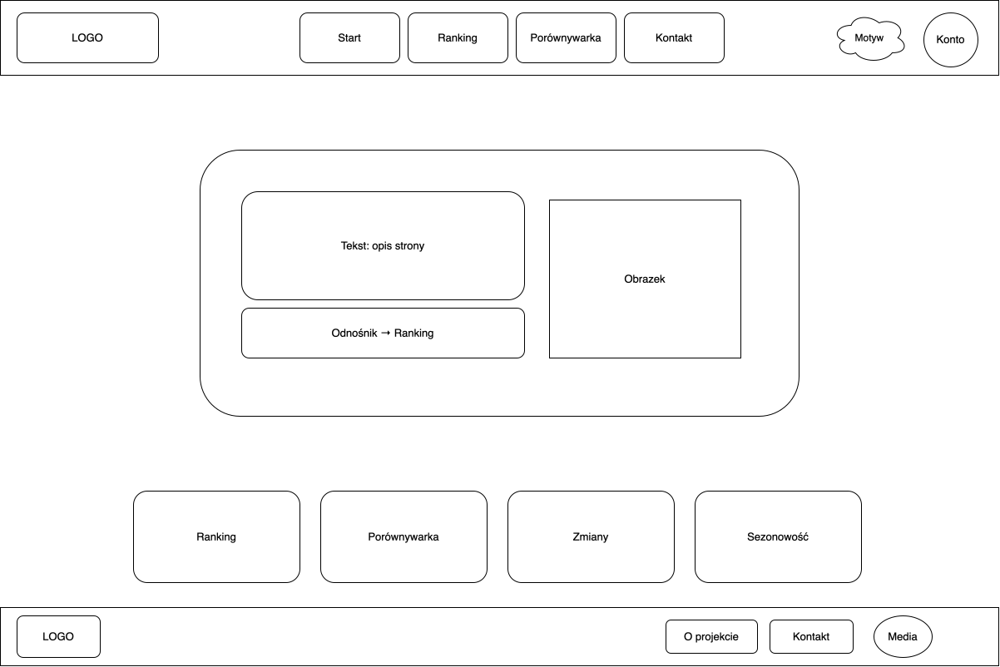
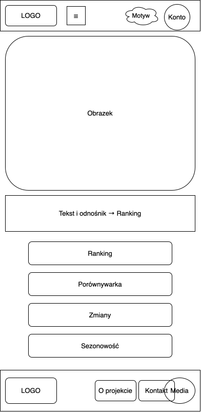
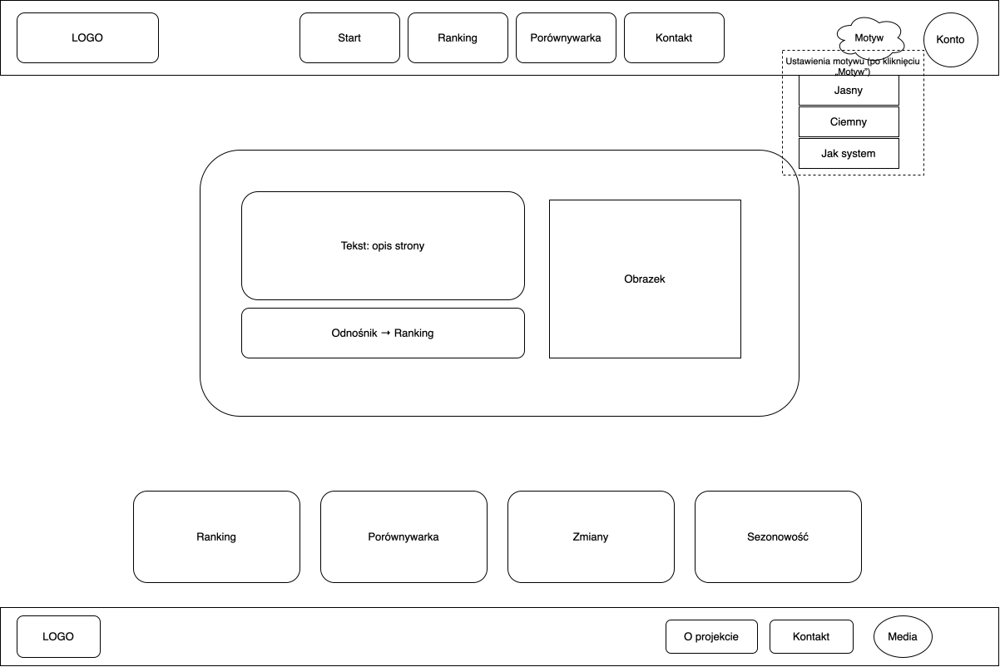
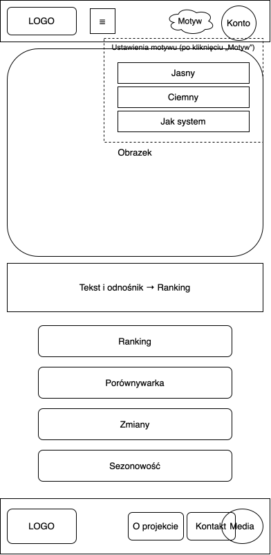

# AeroStat

A web application for exploring passenger traffic at Polish airports, based on public statistics from 2007 to 2023 (domestic traffic, regular and charter flights).

Repository: `airdata-passenger-stats`. The project was formerly called `airtraffic-anomalies`; the scope changed after consultation with the course instructor (see [Project scope](#project-scope)).

## Project scope

The first idea was to detect unusual flight routes using OpenSky data. After consultation with the course instructor, the project was changed to a simpler, data-based application built on quarterly airport statistics.

### Features

- **Ranking:** top 10 airports by passengers or passenger operations, for a selected year and quarter or a whole year. Incomplete years are marked.
- **Comparison:** two or three airports on one line chart, yearly or quarterly, for a selected range of years. Missing quarters are shown as gaps, not zeros.
- **Changes:** airports with the largest growth or decline between two selected years (e.g. 2019 vs 2023). Yearly totals are compared only for airports with all four quarters in both years; the others are listed under the table.
- **Seasonality:** share of each quarter in the yearly total for a selected airport.
- **CSV export:** each table can be downloaded with the current filters (UTF-8 with BOM, semicolons, so Excel shows Polish characters correctly). Available to logged-in users.
- **Theme panel („Motyw”):** light, dark or system theme, larger or smaller text, and reading the page aloud with the browser's built-in speech synthesis.
- **Account („Konto”):** registration, login and logout. Logged-in users can mark favorite airports with a star (☆ / ★) in tables and airport lists.

The site uses only HTML, CSS and JavaScript, with no frameworks or external libraries. Charts are drawn as SVG by the project's own code.

## How to run

The pages load `data/LOTY.csv`, which browsers block when an HTML file is opened directly from disk. Run a local server instead:

1. Open a terminal in the project folder.
2. Start the server:
   - macOS / Linux: `python3 -m http.server`
   - Windows: `python -m http.server` (or `py -m http.server`)
3. Open **http://localhost:8000** in a browser.
4. Stop the server with **Ctrl + C** in the terminal.

## Wireframes

Desktop (1200 px) and mobile (390 px) wireframes, including the theme panel:






## Data

- **File:** [`data/LOTY.csv`](data/LOTY.csv) (semicolon-separated, UTF-8)
- **Columns:** `nazwa_zmiennej`, `port_lotniczy`, `rok`, `kwartal`, `liczba_pasazerow`, `liczba_operacji_pasazerskich`
- **Scope:** 15 Polish airports, years 2007–2023, quarters 1–4
- **Rows:** 829 (a full grid would have 1020, so some airport–quarter combinations are missing)
- **Source:** *https://dane.gov.pl/pl/dataset/3791,ruch-lotniczy-w-polsce-przewozy-pasazerskie-operac/resource/55624/table?page=1&per_page=20&q=&sort=*

**Important:** passengers on domestic routes are counted twice (once at the departure airport and once at the arrival airport). Totals for all airports therefore overstate the number of domestic passengers. Comparisons between airports are fair, because each airport counts in the same way.

## Repository structure

```
airdata-passenger-stats/
├── index.html            Start page (hero, tiles, about the project)
├── ranking.html          Ranking
├── porownywarka.html     Comparison
├── zmiany.html           Changes
├── sezonowosc.html       Seasonality
├── kontakt.html          Contact and data sources ("Media")
├── rejestracja.html      Account registration
├── css/
│   └── style.css         All styles, colors as variables for both themes
├── js/
│   ├── theme.js          Theme panel: colors, text size, reading aloud
│   ├── menu.js           Mobile menu (☰)
│   ├── konto.js          Account panel, registration, favorites, CSV access
│   ├── ranking.js
│   ├── porownywarka.js
│   ├── zmiany.js
│   └── sezonowosc.js
├── img/                  Logo (light and dark versions), illustration, favicon
├── data/
│   └── LOTY.csv
├── design/               Wireframes (SVG and draw.io)
├── luki.md               List of known security weaknesses
├── README.md
└── README.pl.md
```

## Current status

1. **Wireframes:** done. Site map, desktop and mobile wireframes approved by the instructor.
2. **Build:** done. Static HTML, CSS and JavaScript prototype with data loaded from the CSV file.
3. **Analysis:** done. Ranking, comparison, changes and seasonality.
4. **Export:** done. CSV download of the filtered data.
5. **Verification and security (next):** fixing the weaknesses listed in [`luki.md`](luki.md), test scenarios and a before/after report.
6. **Delivery:** deployment instructions.

## Security

Security weaknesses are kept on purpose in this version and documented in [`luki.md`](luki.md). This includes the account system: accounts and passwords are stored in plain text in the browser's `localStorage`, and the login and CSV restrictions work only in the browser. **Do not use a real password when testing.** These issues will be addressed in the next stage.

## Context

University project (Politechnika Rzeszowska).

## Polish version

See [README.pl.md](README.pl.md).
