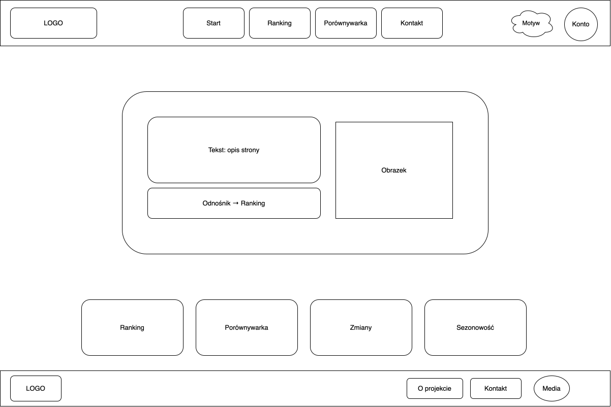
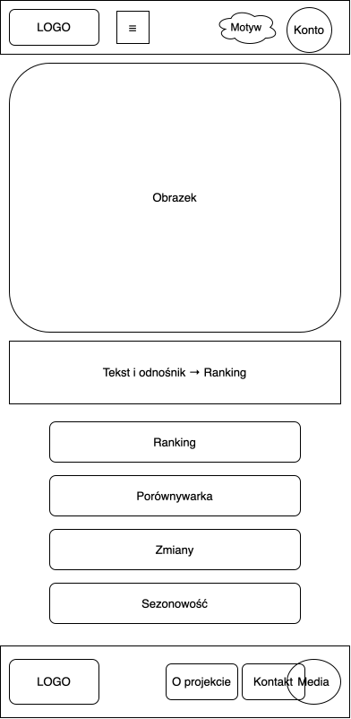
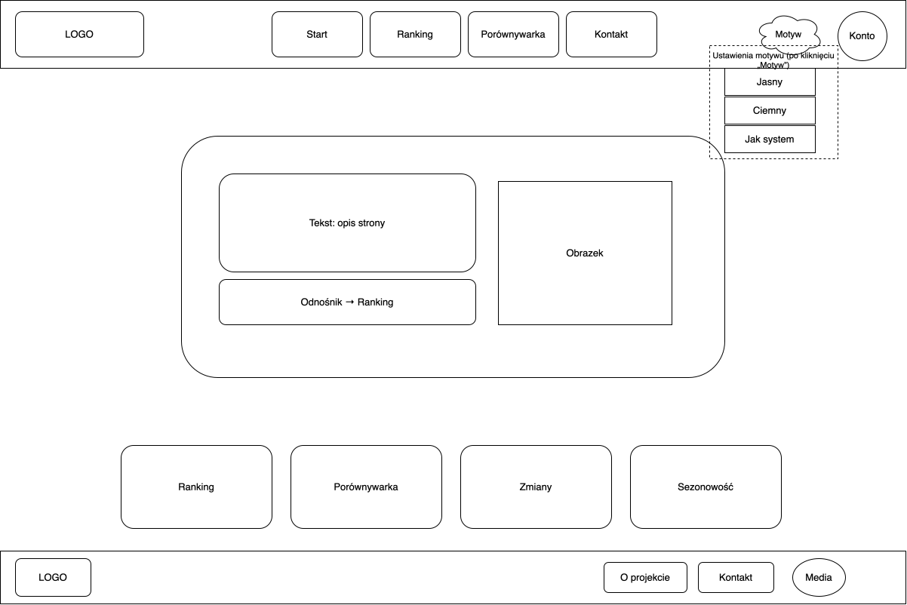
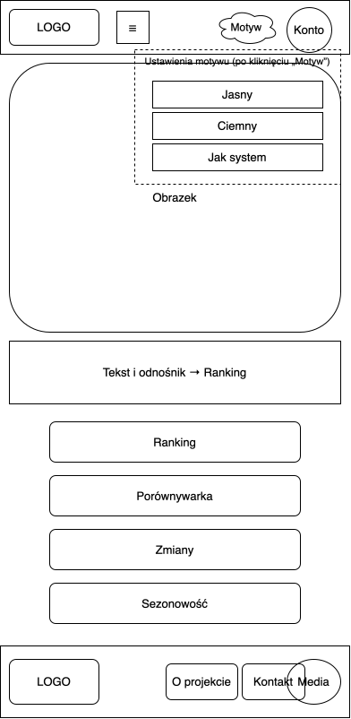

# AeroStat

Aplikacja internetowa do analizy ruchu pasażerskiego na polskich lotniskach, oparta na publicznych statystykach z lat 2007–2023 (ruch krajowy, regularny i czarterowy).

Repozytorium: `airdata-passenger-stats`. Projekt wcześniej nazywał się `airtraffic-anomalies`; zakres zmienił się po konsultacjach z prowadzącym (patrz [Zakres projektu](#zakres-projektu)).

## Zakres projektu

Pierwszy pomysł polegał na wykrywaniu nietypowych tras lotniczych na podstawie danych OpenSky. Po konsultacjach z prowadzącym projekt został zmieniony na prostszą aplikację opartą na kwartalnych statystykach lotnisk.

### Funkcje

- **Ranking:** top 10 lotnisk według liczby pasażerów albo operacji pasażerskich, dla wybranego roku i kwartału lub całego roku. Niepełne lata są oznaczone.
- **Porównywarka:** dwa lub trzy lotniska na jednym wykresie liniowym, w ujęciu rocznym lub kwartalnym, dla wybranego zakresu lat. Brakujące kwartały są przerwą w linii, a nie zerem.
- **Zmiany:** lotniska z największym wzrostem lub spadkiem między dwoma wybranymi latami (np. 2019 i 2023). Porównujemy sumy roczne tylko dla lotnisk, które mają wszystkie 4 kwartały w obu latach; pozostałe są wymienione pod tabelą.
- **Sezonowość:** udział każdego kwartału w roku dla wybranego lotniska.
- **Eksport CSV:** każdą tabelę można pobrać z aktualnymi filtrami (UTF-8 z BOM i średnikami, żeby Excel poprawnie pokazywał polskie znaki). Dostępny dla zalogowanych.
- **Panel „Motyw”:** motyw jasny, ciemny lub zgodny z systemem, powiększanie i pomniejszanie liter oraz czytanie strony na głos (wbudowana funkcja przeglądarki).
- **Konto:** rejestracja, logowanie i wylogowanie. Zalogowani mogą oznaczać ulubione lotniska gwiazdką (☆ / ★) w tabelach i listach lotnisk.

Strona używa wyłącznie HTML, CSS i JavaScriptu, bez frameworków i zewnętrznych bibliotek. Wykresy są rysowane w SVG przez własny kod projektu.

## Jak uruchomić

Strony wczytują plik `data/LOTY.csv`, a przeglądarka blokuje to przy otwieraniu pliku HTML bezpośrednio z dysku. Dlatego trzeba uruchomić lokalny serwer:

1. Otwórz terminal w folderze projektu.
2. Uruchom serwer:
   - macOS / Linux: `python3 -m http.server`
   - Windows: `python -m http.server` (albo `py -m http.server`)
3. Otwórz w przeglądarce **http://localhost:8000**.
4. Serwer wyłączysz, naciskając w terminalu **Ctrl + C**.

## Makiety

Makiety desktopowe (1200 px) i mobilne (390 px), w tym panel motywu:






## Dane

- **Plik:** [`data/LOTY.csv`](data/LOTY.csv) (rozdzielany średnikami, UTF-8)
- **Kolumny:** `nazwa_zmiennej`, `port_lotniczy`, `rok`, `kwartal`, `liczba_pasazerow`, `liczba_operacji_pasazerskich`
- **Zakres:** 15 polskich lotnisk, lata 2007–2023, kwartały 1–4
- **Liczba wierszy:** 829 (pełna siatka miałaby 1020, więc część kombinacji lotnisko–kwartał nie występuje)
- **Źródło:** *https://dane.gov.pl/pl/dataset/3791,ruch-lotniczy-w-polsce-przewozy-pasazerskie-operac/resource/55624/table?page=1&per_page=20&q=&sort=*

**Ważne:** pasażer na trasie krajowej jest liczony dwukrotnie (na lotnisku odlotu i przylotu). Suma dla wszystkich lotnisk zawyża więc liczbę pasażerów krajowych. Porównania między lotniskami są uczciwe, bo każde liczy pasażerów w ten sam sposób.

## Struktura repozytorium

```
airdata-passenger-stats/
├── index.html            Strona Start (hero, kafelki, o projekcie)
├── ranking.html          Ranking
├── porownywarka.html     Porównywarka
├── zmiany.html           Zmiany
├── sezonowosc.html       Sezonowość
├── kontakt.html          Kontakt i źródła danych („Media”)
├── rejestracja.html      Zakładanie konta
├── css/
│   └── style.css         Wszystkie style, kolory jako zmienne dla obu motywów
├── js/
│   ├── theme.js          Panel „Motyw”: kolory, wielkość liter, czytanie na głos
│   ├── menu.js           Menu na telefonie (☰)
│   ├── konto.js          Panel konta, rejestracja, ulubione, dostęp do CSV
│   ├── ranking.js
│   ├── porownywarka.js
│   ├── zmiany.js
│   └── sezonowosc.js
├── img/                  Logo (wersja jasna i ciemna), ilustracja, favicon
├── data/
│   └── LOTY.csv
├── design/               Makiety (SVG i draw.io)
├── luki.md               Lista znanych luk bezpieczeństwa
├── README.md
└── README.pl.md
```

## Aktualny etap

1. **Makiety:** zrobione. Mapa strony, makiety desktopowa i mobilna zatwierdzone przez prowadzącego.
2. **Implementacja:** zrobione. Prototyp w HTML, CSS i JavaScript z danymi wczytywanymi z pliku CSV.
3. **Analiza:** zrobione. Ranking, porównywarka, zmiany i sezonowość.
4. **Eksport:** zrobione. Pobieranie przefiltrowanych danych jako CSV.
5. **Weryfikacja i bezpieczeństwo (następny):** naprawa luk opisanych w [`luki.md`](luki.md), scenariusze testowe i raport PRZED/PO.
6. **Wdrożenie:** instrukcja uruchomienia.

## Bezpieczeństwo

Luki bezpieczeństwa są w tej wersji celowo i są opisane w [`luki.md`](luki.md). Dotyczy to też kont: konta i hasła są zapisane zwykłym tekstem w `localStorage` przeglądarki, a logowanie i blokada pobierania CSV działają tylko w przeglądarce. **Nie używaj prawdziwego hasła podczas testów.** Luki zostaną poprawione w kolejnym etapie.

## Kontekst

Projekt studencki (Politechnika Rzeszowska).

## English version

See [README.md](README.md).
