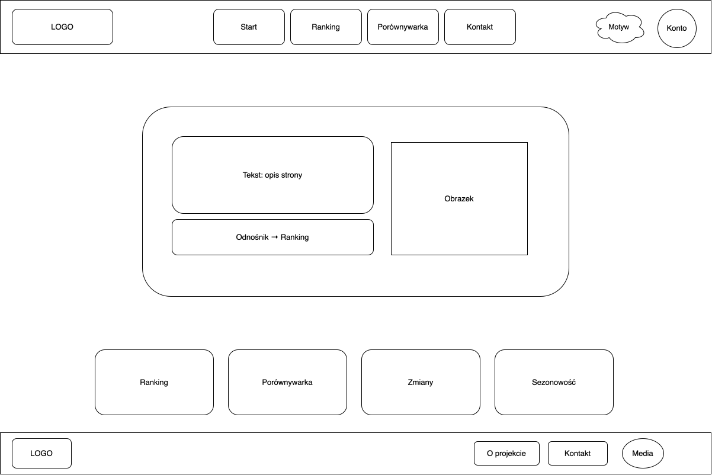
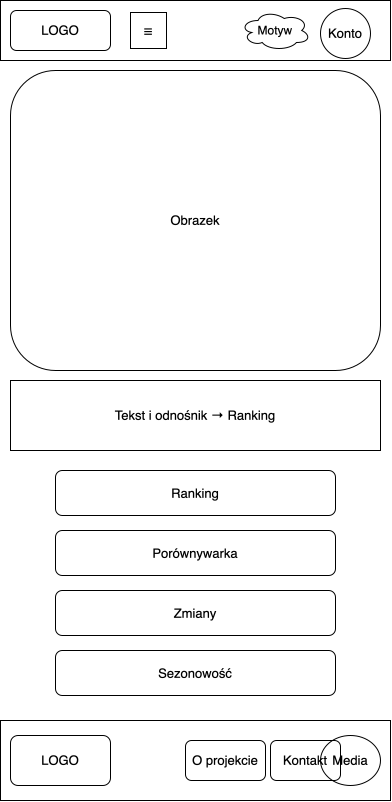
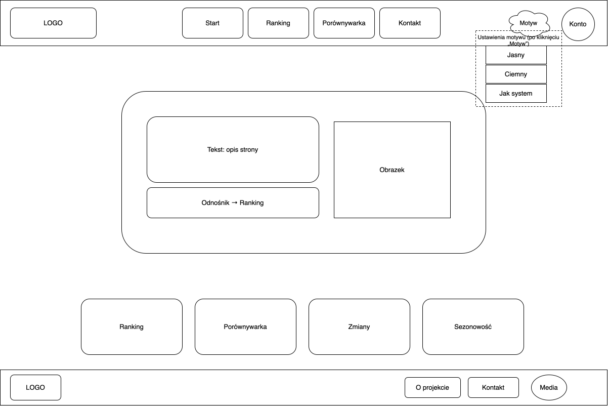
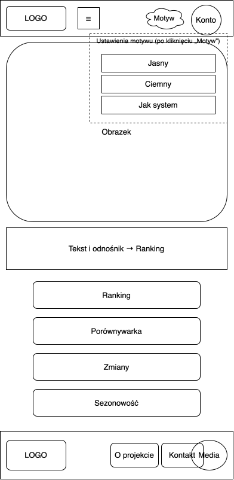

# airdata-passenger-stats

Aplikacja internetowa do analizy ruchu pasażerskiego na polskich lotniskach, oparta na publicznych statystykach z lat 2007–2023 (ruch krajowy, regularny i czarterowy).

> Wcześniej nazywała się `airtraffic-anomalies`. Zakres zmienił się po konsultacjach z prowadzącym (patrz [Zakres projektu](#zakres-projektu)).

## Zakres projektu

Pierwszy pomysł polegał na wykrywaniu nietypowych tras lotniczych na podstawie danych OpenSky. Po konsultacjach z prowadzącym projekt został zmieniony na prostszą aplikację opartą na kwartalnych statystykach lotnisk.

### Funkcje

- **Ranking:** top 10 lotnisk według liczby obsłużonych pasażerów, dla wybranego roku i kwartału.
- **Porównywarka:** dwa lotniska na jednym wykresie liniowym, pokazującym liczbę pasażerów w czasie.
- **Zmiany:** lotniska z największym wzrostem lub spadkiem między dwoma wybranymi latami (np. 2019 i 2023).
- **Sezonowość:** udział każdego kwartału w roku dla wybranego lotniska.
- **Pasażerów na operację:** `pasażerowie / operacje pasażerskie`, z wyjaśnieniem wskaźnika.
- **Eksport CSV:** każda tabela może zostać pobrana z aktualnie wybranymi filtrami.
- **Motyw:** jasny, ciemny lub zgodny z systemem, ustawiany przyciskiem „Motyw”.

## Makiety

Makiety desktopowe (1200 px) i mobilne (390 px), w tym panel motywu:

## Dane

- **Plik:** [`data/LOTY.csv`](data/LOTY.csv) (rozdzielany średnikami, UTF-8)
- **Kolumny:** `nazwa_zmiennej`, `port_lotniczy`, `rok`, `kwartal`, `liczba_pasazerow`, `liczba_operacji_pasazerskich`
- **Zakres:** 15 polskich lotnisk, lata 2007–2023, kwartały 1–4
- **Liczba wierszy:** 829 (pełna siatka miałaby 1020, więc część kombinacji lotnisko–kwartał nie występuje)
- **Źródło:** *https://dane.gov.pl/pl/dataset/3791,ruch-lotniczy-w-polsce-przewozy-pasazerskie-operac/resource/55624/table?page=1&per_page=20&q=&sort=*

**Ważne:** pasażer na trasie krajowej jest liczony dwukrotnie (na lotnisku odlotu i przylotu). Suma dla wszystkich lotnisk zawyża więc liczbę pasażerów krajowych. Porównania między lotniskami są uczciwe, bo każde liczy pasażerów w ten sam sposób.

## Struktura repozytorium

airdata-passenger-stats/
├── README.md
├── README.pl.md
├── data/
│ └── LOTY.csv
└── design/
├── desktop-1200.svg
├── mobile-390.svg
├── desktop-theme-open.svg
└── mobile-theme-open.svg

## Aktualny etap

**Etap 1: Makiety (zrobione)**
- Mapa strony: Start, Ranking, Porównywarka, Zmiany, Sezonowość, plus Kontakt
- Makiety desktopowa i mobilna, zatwierdzone przez prowadzącego
- Panel motywu po kliknięciu „Motyw”
- Opis interakcji użytkownika

## Planowane etapy

2. **Implementacja (następny):** prototyp w HTML, CSS i JavaScript, z danymi wczytanymi z pliku CSV
3. **Analiza:** obliczenia dla rankingu, porównywarki, zmian i sezonowości
4. **Eksport:** pobieranie przefiltrowanych danych jako CSV
5. **Weryfikacja:** scenariusze testowe i raport PRZED/PO
6. **Wdrożenie:** instrukcja uruchomienia

## Kontekst

Projekt studencki (Politechnika Rzeszowska). Luki bezpieczeństwa są w pierwszej wersji celowo i zostaną poprawione w późniejszym etapie.

## English version

See [README.md](README.md).